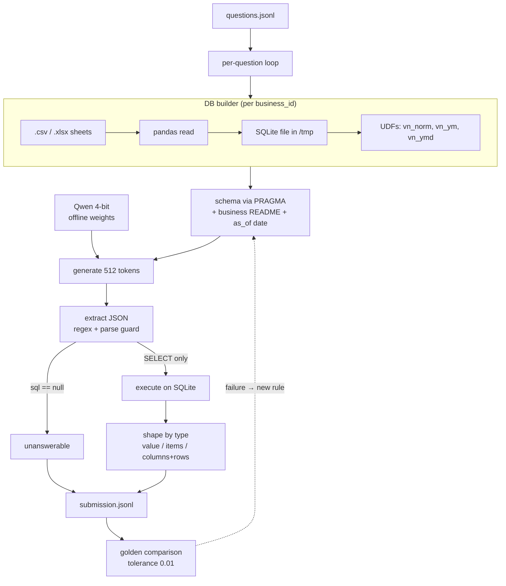
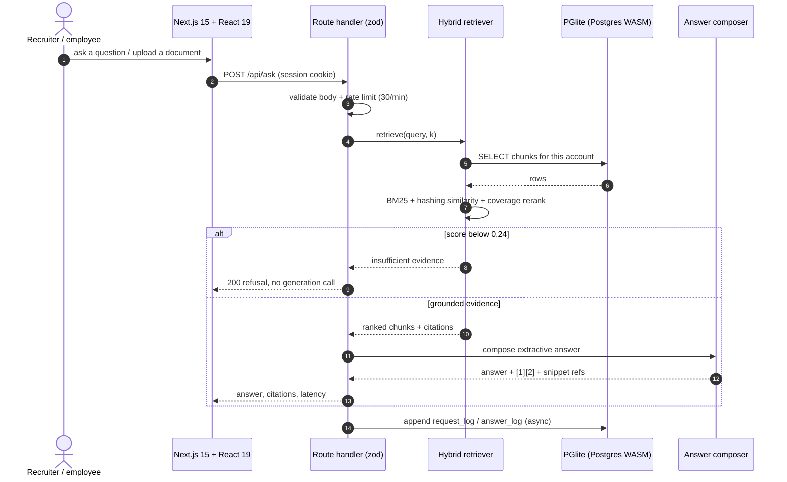
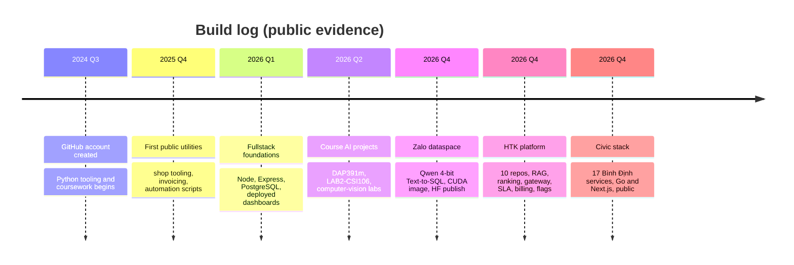

<!-- ═══════════════════════════════════════════════════════════════════════════ -->
<!--  shirmtry · AI × Fullstack Command Center                                  -->
<!--  model → serving → API → UI → deploy → monitor                             -->
<!--  Every claim below is grounded in a public repo. TBD = deliberately open.   -->
<!-- ═══════════════════════════════════════════════════════════════════════════ -->

<div align="center">


<a href="https://git.io/typing-svg"></a>

<br/>


<br/><br/>

`IDENTITY` · [`METRICS`](#02--live-system-metrics) · [`AI STACK`](#03--ai-stack-arsenal) · [`FULLSTACK`](#04--fullstack-stack-arsenal) · [`BRIDGE`](#05--the-bridge-ai--product) · [`PROJECTS`](#06--project-battlefield) · [`ARCHITECTURE`](#07--end-to-end-architecture) · [`SERVING`](#08--inference--serving-notes) · [`AUTOMATION`](#10--automation--cicd) · [`CONTACT`](#16--contact--war-room)

</div>

---

## 01 · Identity & Mission

> **AI Engineer with fullstack capability.**
> I build end-to-end AI products: **model → serving → API → UI → deploy → monitor.**
> Core stack: **PyTorch / Transformers / Qwen / ONNX on one side — Next.js 15 / TypeScript / PostgreSQL / Docker on the other.**

> *"A model that never reaches a user is just an experiment."*

I am not optimizing for a leaderboard I cannot deploy. The interesting work is the seam: quantizing a 4-bit LLM so it fits a single GPU **and** wrapping it in a typed API that refuses unanswerable questions; training a detector **and** shipping the dashboard someone opens at 7 a.m. That seam is where most AI projects die, and it is the part I own.

| Field | Value |
|---|---|
| **Name / handle** | Đinh Tấn Huy · [`shirmtry`](https://github.com/shirmtry) · HUYTKING |
| **Location / TZ** | Quy Nhơn, Bình Định, Vietnam · **UTC+7** |
| **Current focus** | Text-to-SQL over messy Vietnamese business data · hybrid RAG with citations · eval gates |
| **AI stack** | PyTorch 2.1 · Transformers · Qwen-family SQL model (4-bit, base version TBD) · YOLOv8/v11 · OpenCV · ONNX · scikit-learn |
| **Fullstack stack** | Next.js 15 · React 19 · TypeScript · Tailwind · PostgreSQL (PGlite) · Go · Vercel · Docker |
| **Open to** | AI Engineer / AI Product Engineer roles · fullstack AI builds · freelance (AI × web × IoT) |
| **Language** | Vietnamese (native) · English (IELTS 5.0 — improving, writing docs in English) |

```text
$ whoami
Đinh Tấn Huy (@shirmtry) — IT student @ FPT University Quy Nhơn, freelance builder

$ cat /etc/positioning
ai_engineer   : training, quantization, offline inference, evaluation, serving
fullstack     : API design, auth, SQL schema, caching, CI/CD, observability
differentiator: I connect the two — a model becomes a product, not a demo

$ uptime
39 public repos · 10-repo fullstack platform · 1 shipped LLM competition stack
```

---

## 02 · Live System Metrics

<div align="center">
<sub>Live plates, dark theme. If one renders blank, the public widget instance is rate-limited — refresh in a minute. Uptime of my own services is tracked in §15, not by a badge.</sub>
</div>

<table align="center" width="100%">
<tr>
<td width="50%" align="center">
<a href="https://github.com/shirmtry"></a>
<sub><b>commit / PR / issue volume</b></sub>
</td>
<td width="50%" align="center">
<a href="https://github.com/shirmtry"></a>
<sub><b>consecutive shipping days</b></sub>
</td>
</tr>
<tr>
<td width="50%" align="center">
<a href="https://github.com/shirmtry"></a>
<sub><b>repo mix: TypeScript, Python, Go, HTML — products, not samples</b></sub>
</td>
<td width="50%" align="center">
<a href="https://github.com/shirmtry?tab=repositories"></a>
<sub><b>commits by UTC+7 hour — night build bias</b></sub>
</td>
</tr>
<tr>
<td colspan="2" align="center">

</td>
</tr>
<tr>
<td colspan="2" align="center">

</td>
</tr>
</table>

<p align="center">

<br/>
<sub>Snake is regenerated twice a day by <a href=".github/workflows/snake.yml"><code>snake.yml</code></a> — see §10.</sub>
</p>

---

## 03 · AI Stack Arsenal

From raw labels to a quantized artifact that runs offline. The left column is what I actually touch; the right column is what it produced in a repo you can open.

<table>
<tr><td><b>Modeling / Training</b></td><td>


</td></tr>
<tr><td><b>Computer Vision</b></td><td>


</td></tr>
<tr><td><b>NLP / LLM</b></td><td>


</td></tr>
<tr><td><b>Data Engineering</b></td><td>


</td></tr>
<tr><td><b>Model Serving</b></td><td>


</td></tr>
<tr><td><b>MLOps / Evaluation</b></td><td>


</td></tr>
<tr><td><b>Notebook / R&amp;D</b></td><td>


</td></tr>
</table>

<p align="center"></p>

**What "used" means here — not a logo wall:**

| Capability | Evidence repo | Concrete artifact |
|---|---|---|
| 4-bit LLM inference | `zalo_htk_no1` | Qwen merged-4bit loaded offline, `device_map="auto"`, 512 new tokens per JSON answer |
| Prompt as a contract | `zalo_htk_no1` | 20-rule system prompt encoding Vietnamese Excel quirks, SQL safety, answer shapes |
| Retrieval without a vector service | `htk-document-qa` | 256-dim hashing embedding + BM25 + coverage rerank, all in TypeScript |
| Ranking with evaluation | `htk-resume-matcher` | precision@5 / recall@10 / MRR on a 3-job, 12-CV golden set with a 0.60/0.90/0.80 gate |
| Vision pipeline | classroom-monitor, `TECH-DRONE`, license-plate stack | YOLO + DeepFace/MediaPipe + OpenCV streaming to a storage layer |
| Reproducible GPU build | `zalo_htk_no1/.github/workflows/build.yml` | CUDA 11.8 image → 11 GB tar → MD5 → Hugging Face dataset upload |

---

## 04 · Fullstack Stack Arsenal

The other half of the job. A model endpoint is an API contract with p95, auth and a failure mode — so I build the contract, not only the model.

<table>
<tr><td><b>Frontend</b></td><td>


</td></tr>
<tr><td><b>Backend / API</b></td><td>


</td></tr>
<tr><td><b>DB / Storage</b></td><td>


</td></tr>
<tr><td><b>Auth / Realtime</b></td><td>


</td></tr>
<tr><td><b>DevOps / Cloud</b></td><td>


</td></tr>
<tr><td><b>Tools</b></td><td>


</td></tr>
</table>

<p align="center"></p>
<p align="center"></p>
<p align="center"></p>

**The fullstack decisions I can defend in a review:**

| Concern | Default choice | Why | When I would change it |
|---|---|---|---|
| API shape | Next.js route handlers + zod at the boundary | one deploy, shared types, validation at the edge | separate FastAPI service when GPUs or long jobs are involved |
| Auth | scrypt password hash + httpOnly session cookie | no token-in-localStorage XSS surface, simple revocation | OAuth2/OIDC when enterprise SSO is a requirement |
| DB | PostgreSQL semantics via PGlite for demo scale | real SQL, real migrations, zero managed-service cost | managed Postgres + pgvector once corpus exceeds a few thousand chunks |
| Cache / limits | in-memory token bucket per key + endpoint | predictable, dependency-free, testable | Redis token bucket for multi-instance correctness |
| Logging | async buffered writes off the hot path | p95 does not depend on DB write speed | durable queue (Kafka/SQS) when a dropped log is unacceptable |
| Deploy | Docker for GPU, Vercel for the web tier | right runtime per workload | one Kubernetes cluster when the team owns the network |

---

## 05 · The Bridge (AI → Product)

This is the section that separates an AI engineer who ships from a model trainer. Ten stages, one owner, no handoff gap.

| # | Stage | What I actually do | Tools | Output |
|:-:|---|---|---|---|
| 1 | **Data collection** | Parse real Vietnamese business exports — merged headers, footer totals, continuation rows, duplicate lines | pandas, openpyxl | raw DataFrames |
| 2 | **Data pipeline** | Build a SQLite DB per business, load every CSV/XLSX sheet, normalize names and dates | SQLite, `to_sql` | queryable schema |
| 3 | **Data semantics** | Encode domain rules: forward-fill order IDs, reject "TỔNG NGÀY" rows, dedupe full rows | CTE (`s/g/f/d`), UDFs | correct aggregates |
| 4 | **Training / adaptation** | Merge a domain-tuned Qwen SQL checkpoint, 4-bit quantize, validate numerics | PyTorch 2.1, Transformers, bitsandbytes | model directory |
| 5 | **Evaluation** | Golden questions, absolute tolerance 0.01, refusal on unanswerable questions | JSONL audits, pandas | scorecard per run |
| 6 | **Prompt as code** | 20 numbered rules covering status filters, integer division, list vs table shape | chat template | constrained system prompt |
| 7 | **Export / package** | Bake weights into a CUDA 11.8 image, `docker save`, checksum, publish | Docker, md5sum, HF Hub | 11 GB artifact + MD5 |
| 8 | **Serving** | Offline batch generation, JSON extraction with regex fallback, guarded `SELECT`-only execution | transformers, sqlite3 | `submission.jsonl` |
| 9 | **API layer** | Typed request/response, validation, 429 + retry-after, request IDs | route handlers, zod | `/api/ask`, `/api/gw/:slug` |
| 10 | **UI + observability** | Citation rendering, refusal states, p50/p95, error rate, quota and audit views | React 19, Tailwind, PGlite | dashboard a human uses |

```mermaid
flowchart LR
    subgraph DATA["1 · Data"]
      A1["Excel / CSV exports"] --> A2["pandas + openpyxl"]
      A2 --> A3["SQLite<br/>vn_norm / vn_ym / vn_ymd"]
    end
    subgraph MODEL["2 · Model"]
      B1["Qwen-SQL<br/>merged checkpoint"] --> B2["4-bit quantize"]
      B2 --> B3["offline weights<br/>+ chat template"]
    end
    subgraph SERVE["3 · Serving"]
      C1["batch generate<br/>512 tokens"] --> C2["JSON extract<br/>regex fallback"]
      C2 --> C3["SELECT-only guard"]
      C3 --> C4["submission.jsonl"]
    end
    subgraph PRODUCT["4 · Product"]
      D1["Route handler<br/>zod contract"] --> D2["React 19 UI<br/>citations + refusal"]
      D2 --> D3["logs: p50/p95<br/>error rate"]
    end
    A3 --> B1
    B3 --> C1
    C4 --> D1
    D3 -.->|"hard cases become new golden rows"| A1
```



**Why the pipeline is shaped this way**

- **Schema is part of the prompt, not an afterthought.** `PRAGMA table_info` output plus the business README is injected per request, so the model never invents a column name.
- **Determinism before creativity.** SQL is constrained to `SELECT`, executed with a row limit, and any parse failure becomes `unanswerable` instead of a hallucinated number.
- **The forward-fill CTE exists because real Excel lies.** Continuation rows have `NULL` order IDs; filtering before filling silently deletes revenue. The fix lives in SQL, not in a prompt apology.
- **Evaluation is a file, not a feeling.** Every rule in the prompt traces back to a failed golden question.
- **Packaging is deployment.** An 11 GB image with a checksum is the contract that the offline judge environment will run exactly what I measured.

> **I own the full path, not just one stage.**

---

## 06 · Project Battlefield

Eight systems, not eight tutorials. Every row has an AI core **and** a product layer.

| Project | AI Core | Fullstack Layer | Stack | Status | Link |
|---|---|---|---|---|---|
| **Zalo Text-to-SQL Engine** | Qwen-family 4-bit SQL checkpoint → SQL over messy Vietnamese sales data; 20-rule prompt; forward-fill + dedupe CTEs; answer-shape classifier (`number/percent/list/table/date/string/boolean/unanswerable`) | Offline GPU batch runner, SQLite builder with custom UDFs, JSON contract, MD5-checksummed image published to HF | `Python` `Transformers` `PyTorch` `CUDA` `SQLite` `pandas` `Docker` | **Shipped** (competition submission) | [`zalo_htk_no1`](https://github.com/shirmtry/zalo_htk_no1) |
| **Datamate Solver** | Agentic solver loop for the same dataspace problem family: auto-solver, schema utils, public-test harness, submission writer | Reproducible corpus + `run_all.sh` + versioned submissions; model weights hosted on HF | `Python` `SQLite` `pandas` `HF Hub` | **Shipped** (v999) | [`datamate-agent`](https://github.com/shirmtry/datamate-agent) |
| **HTK Document QA** | Hybrid retrieval: 256-dim hashing dense + BM25 + coverage rerank; mandatory `[1][2]` citations; refusal below score `0.24` without calling an LLM; 9-question golden set (recall@5, MRR, refusal accuracy) | Real auth (scrypt + httpOnly), per-account corpora, ingest UI, rate limits per route, p50/p95 runtime metrics | `Next.js 15` `React 19` `TypeScript` `PGlite` `Vercel Blob` `Vitest` | **Live demo** | [`htk-document-qa`](https://github.com/shirmtry/htk-document-qa) |
| **HTK Match (Resume Ranking)** | Explainable scoring: 0.50 required-skill coverage + 0.32 IDF keyword overlap + 0.18 seniority; golden 0/1/2 labels; precision@5 / recall@10 / MRR regression gate | Recruiter workspace, CV upload (200 KB), per-user isolation, eval history table, feedback that never pollutes the gate | `Next.js 15` `React 19` `TypeScript` `PGlite` `Vitest` | **Live demo** | [`htk-resume-matcher`](https://github.com/shirmtry/htk-resume-matcher) |
| **HTK Gateway** | Not an LLM — an inference-adjacent control plane: hashed API keys, token bucket per key × endpoint, monthly UTC quota, async buffered logs with `droppedLogs` accounting | Catch-all proxy route, sandbox upstreams (`echo/slow/fail`), SSRF guards, dashboard for RPS, error rate, p50/p95, quota per key | `Next.js 15` `TypeScript` `PGlite` `Vercel Blob` | **Live demo** | [`htk-api-gateway`](https://github.com/shirmtry/htk-api-gateway) |
| **HTK Support** | SLA computation engine: package × priority clocks, auto-escalation on breach, reopen-resets-clock semantics | RBAC (admin/agent/customer), server-side filtering of internal notes, audit trail, email outbox, cron-protected SLA sweep | `Next.js 15` `TypeScript` `PGlite` `zod` | **Live demo** | [`htk-support-ticketing`](https://github.com/shirmtry/htk-support-ticketing) |
| **Classroom Affect & Behavior Monitor** | YOLO face/person detection + DeepFace emotion + MediaPipe behavior cues over a camera stream; low-latency frame pipeline | REST ingestion, MongoDB event log, React analytics dashboard for per-session trends | `Python` `YOLO` `DeepFace` `MediaPipe` `MongoDB` `React` | **Private build** | `TBD` — repo not public; architecture notes on request |
| **Bình Định Civic Stack** | Heuristic risk scoring and geodata aggregation for flood, landslide, storm and traffic; deliberately no inflated deep-learning claims | 17 deployable services: Go APIs, EJS/HTML dashboards, map views, alerts; each repo self-contained | `Go` `Node.js` `EJS` `JavaScript` `HTML` | **Public, iterating** | [`binhdinh-*`](https://github.com/shirmtry?tab=repositories&q=binhdinh) |

<details>
<summary><b>Two more rows that did not fit the table</b></summary>

| Project | AI Core | Fullstack Layer | Stack | Status |
|---|---|---|---|---|
| **License Plate & Parking** | Plate detection + OCR with preprocessing for blur/angle/low light | Express REST API, PostgreSQL records, parking management UI | `YOLO` `OCR` `Express` `PostgreSQL` | `TBD` — repo not public yet |
| **Dual-Axis Solar + ESP32** | Control heuristic for panel orientation (not deep learning — and that is the right call) | ESP32 firmware → serverless Redis → Streamlit dashboard | `C/C++` `ESP32` `ROS` `Gazebo` `Redis` `Streamlit` | Course build, private |

</details>

**Reading the table honestly:** the LLM work proves I can handle quantization, prompting, evaluation and offline serving. The HTK services prove I can design auth, schemas, rate limits, audit trails and dashboards. Neither half is a portfolio costume — the interesting claim is the join.

---

## 07 · End-to-End Architecture

Two views of the same discipline: one offline pipeline, one online request. Both are implemented in the repos above — no aspirational boxes.

### 7.1 Offline: messy Excel → verified SQL answers



### 7.2 Online: one grounded request through the RAG API



**Technical decisions and their cost**

- **Guard before generate.** Refusal is decided by retrieval score (`< 0.24`), so an unanswerable question costs one index scan, not one hallucination. Trade-off: a weak retriever refuses too often — visible in refusal accuracy, not hidden.
- **Hybrid because pure vectors lose exact tokens.** BM25 catches product codes and proper nouns; dense catches paraphrases; rerank resolves the disagreement. Trade-off: more moving parts to evaluate.
- **PGlite instead of managed Postgres.** Real SQL and migrations with zero billing, at the cost of single-writer semantics and lambda-level eventual consistency. Accepted for demo scale, documented in the README.
- **No external embedding API.** Hashing embeddings keep the corpus private and the bill at zero, but they do not understand distant synonyms — the golden set makes that limitation measurable.
- **Batch offline for the LLM, online for the product.** Text-to-SQL is a judged batch job (seconds per row are fine); product APIs get strict p95 budgets. Different latency contracts, different architecture.

---

## 08 · Inference & Serving Notes

Serving is where accuracy claims meet physics. These are the levers I have actually pulled, plus the trade-off I accepted.

| Technique | Use case | Trade-off I accepted |
|---|---|---|
| **4-bit quantization (bitsandbytes)** | Fit a coding LLM on one GPU for offline evaluation | Numeric formatting drift risk; mitigate by validating on golden numbers, not vibes |
| **Merged checkpoint** | Avoid re-quantizing at container start | Bigger image (~11 GB) but deterministic cold start |
| **Context cap 4096 + 512 new tokens** | Long schema + README, short JSON answer | Very long SQL can truncate — the JSON parse guard converts that into `unanswerable`, not a wrong number |
| **`SELECT`-only execution guard** | Never let generated SQL mutate the database | Some legitimate analytical patterns (temp tables) are rejected |
| **Offline batch generation** | Judge environment without network | No dynamic batching across processes; throughput is single-stream |
| **ONNX / TensorRT export** | CV models on CPU or edge devices | Export friction with dynamic shapes; re-export per opset |
| **Async log buffer (gateway)** | Keep p95 off the DB write path | A killed instance loses the unflushed window; `droppedLogs` makes the loss visible |
| **Response cache / quota counters** | Repeated identical asks, per-key limits | Staleness and multi-instance undercounting without Redis |
| **CPU ↔ GPU split** | GPU only for generation, CPU for parsing and SQL | Extra hop; worth it when GPU seconds are the scarce resource |

**Hard lessons from real runs**

- **`CAST` in a JOIN condition kills the index.** SQLite silently falls back to a scan and the query times out — a performance bug hiding as a correctness bug.
- **Integer division is a silent accuracy bug.** `SUM(x)/SUM(y)` returns an integer when both are integers; every ratio needs `* 1.0` and `NULLIF` on the denominator.
- **Percent answers need more decimals than feels natural.** The grader tolerance is 0.01, so rounding to two decimals can flip a correct answer to wrong. I round to four.
- **`NOT LIKE '%huy%'` deletes "đang vận chuyển".** Status filtering must be exact-prefix or normalized equality, never a loose substring.
- **Cold start is a product feature.** Quantized weights inside the image beat downloading a checkpoint at boot; the checksum is how I prove both environments ran the same bytes.
- **Latency budget belongs in the contract.** If a route has no p95 target, nobody notices when it becomes 4 seconds.

```python
# Serving contract I use for generated SQL: fail closed, never guess.
sql = out.get("sql")
if sql is None or out.get("type") == "unanswerable":
    answer = {"value": None}          # honest refusal
elif not re.match(r"^\s*(select|with)\b", sql, re.I):
    answer = {"value": None}          # reject anything that is not a read
else:
    df = pd.read_sql_query(f"SELECT * FROM ({sql}) LIMIT 10000", conn)
```

```python
# CV export path: one graph, two runtimes (server GPU / edge CPU).
torch.onnx.export(
    model, dummy, "detector.onnx",
    input_names=["images"], output_names=["boxes", "scores"],
    dynamic_axes={"images": {0: "batch", 2: "h", 3: "w"}},
    opset_version=17,
)
# trade-off: dynamic shapes cost some TensorRT optimization, but one artifact serves many cameras
```

---

## 09 · Engineering Philosophy (AI × Fullstack edition)

1. **A model without an API is a demo, not a product.** If a user cannot reach it with a request and a response, it is a notebook artifact.
2. **Measure latency before bragging about accuracy.** A 0.92 model at 9 seconds loses to a 0.88 model at 300 ms for most product surfaces.
3. **Fail closed on generated code and generated numbers.** Refusal is a feature; a confident wrong aggregate is a data incident.
4. **Put the domain rules in the prompt and the invariants in the database.** Prompts persuade; constraints enforce.
5. **Boring tech for the critical path, new tech at the edge.** Postgres and Docker under the product; the shiny thing in an evaluation branch.
6. **Evaluate the pipeline, not the checkpoint.** Retrieval, prompt, parsing, SQL execution and answer shaping all lose points independently.
7. **If it is not monitored, it is not deployed.** p50/p95, error rate, refusal rate and quota are part of the definition of done.
8. **Automate the third manual repetition.** Twice is a task; three times is a workflow file.
9. **Write the trade-off down while it is still a choice.** Every architecture README here has a "cost" section — future-you needs the reasoning, not the diagram.

---

## 10 · Automation & CI/CD

Three pipelines: one keeps this profile honest, one draws the contribution field, one builds and publishes the GPU inference artifact.

| Workflow | Trigger | What it does | Status |
|---|---|---|---|
| [`update-profile.yml`](.github/workflows/update-profile.yml) | `schedule: 03:17 UTC daily` + `workflow_dispatch` | Reads the GitHub API, rewrites the telemetry block between `AUTO` markers, commits with `[skip ci]` |  |
| [`snake.yml`](.github/workflows/snake.yml) | push to `main` · every 12 h · manual | Renders the contribution snake to the `output` branch with a dark palette |  |
| [`build.yml`](https://github.com/shirmtry/zalo_htk_no1/blob/main/.github/workflows/build.yml) | push + manual (in `zalo_htk_no1`) | Frees disk, downloads weights, builds CUDA image, saves tar, computes MD5, uploads to HF Hub |  |

```yaml
# .github/workflows/update-profile.yml (core)
on:
  schedule: [{ cron: "17 3 * * *" }]   # off-peak, avoids the top-of-hour scheduler spike
  workflow_dispatch:
permissions:
  contents: write
concurrency:
  group: profile-telemetry
  cancel-in-progress: true
jobs:
  refresh:
    runs-on: ubuntu-latest
    steps:
      - uses: actions/checkout@v4
      - run: python .github/scripts/update_profile.py
        env:
          GH_TOKEN: ${{ secrets.GITHUB_TOKEN }}
      - run: |
          if git diff --quiet README.md; then
            echo "No change, nothing to commit."
            exit 0
          fi
          git config user.name  "github-actions[bot]"
          git config user.email "41898282+github-actions[bot]@users.noreply.github.com"
          git add README.md
          git commit -m "chore: auto-update profile [skip ci]"
          git push
```

**How the loop stays safe**

- The updater only rewrites the telemetry block delimited by the two AUTO comment markers in the footer; hand-written prose is never touched.
- It exits silently when the rendered string is unchanged, so the commit graph does not fill with empty telemetry commits.
- `[skip ci]` prevents the bot commit from re-triggering the workflow; `concurrency` prevents overlapping runs.
- The HF publish job uses a repository secret (`HF_TOKEN`) and uploads both the artifact and its MD5 so a corrupted transfer is detectable.
- Workflow files can only be pushed by a token with the `workflow` scope — this repo's automation was authored with that scope deliberately.

---

## 11 · Lab Notes / Currently Exploring

Working notes, not announcements. Progress is my own estimate; each item ends in something shippable.

- **Agentic SQL repair loop** — generate → execute → inspect error → repair, capped at 2 retries. The current pipeline fails closed; a bounded repair loop should convert some refusals into correct answers without inventing numbers. `[████░] 80%`
- **pgvector + HNSW migration for HTK Document QA** — PGlite scans are fine for six documents, not for thousands of chunks. Next step: managed Postgres, `vector(1536)`, HNSW index, keep BM25 for exact codes. `[███░░] 60%`
- **LLM answer synthesis behind the citation guard** — today the composer is extractive. Adding a generative layer only after the refusal threshold and citation coverage can be enforced post-generation. `[███░░] 55%`
- **ONNX → TFLite edge path for vision** — one detector artifact for server GPU and CPU-only devices; measure the accuracy delta from dynamic-shape export before committing. `[██░░░] 40%`
- **Streaming inference over SSE** — first-token latency matters more than total latency for chat surfaces; needs a cancellation path and backpressure. `[██░░░] 35%`
- **Feature-store thinking for tabular models** — point-in-time correctness is the part tutorials skip; prototyping with a small churn dataset. `[█░░░░] 20%`
- **Drift detection for text inputs** — track query length, language mix, refusal rate and retrieval score distributions as early warning signals. `[█░░░░] 15%`
- **WebGPU browser inference** — interesting for privacy-preserving demos; blocked on model size and cold-start, not on enthusiasm. `[░░░░░] 5%`

---

## 12 · Reading List / Papers & Docs

The list is deliberately narrow: serving, quantization, retrieval and evaluation — the four places where AI products actually break.

| Title | Type | Why it matters to my work |
|---|---|---|
| [Efficient Memory Management for LLM Serving with PagedAttention (vLLM)](https://arxiv.org/abs/2309.06180) | Paper | Explains KV-cache fragmentation and why throughput collapses without paged memory |
| [GPTQ: Accurate Post-Training Quantization for GPT](https://arxiv.org/abs/2210.17323) | Paper | The basis for understanding what 4-bit weights cost in accuracy |
| [AWQ: Activation-aware Weight Quantization](https://arxiv.org/abs/2306.00978) | Paper | Why protecting salient channels beats naive rounding |
| [Retrieval-Augmented Generation for Knowledge-Intensive NLP](https://arxiv.org/abs/2005.11401) | Paper | The original RAG formulation; useful baseline for what citations must prove |
| [Lost in the Middle: How Language Models Use Long Contexts](https://arxiv.org/abs/2307.03172) | Paper | Direct argument for reranking and short, high-precision context |
| [RAGAS: Automated Evaluation of Retrieval Augmented Generation](https://arxiv.org/abs/2309.15217) | Paper | Framework for faithfulness/context metrics beyond exact match |
| [ONNX Runtime documentation](https://onnxruntime.ai/docs/) | Docs | Export, graph optimization and execution-provider trade-offs |
| [pgvector](https://github.com/pgvector/pgvector) | Repo | HNSW/IVFFlat tuning for the Postgres-native retrieval path |
| [Triton Inference Server](https://github.com/triton-inference-server/server) | Repo | Multi-framework serving, dynamic batching, model repositories |
| [SQLite query planner overview](https://www.sqlite.org/optoverview.html) | Docs | Why `CAST` in a join drops the index and turns a query into a table scan |
| [OWASP Top 10 for LLM Applications](https://genai.owasp.org/llm-top-10/) | Docs | Prompt injection and insecure output handling — the API-layer threat model |

---

## 13 · Toolbox & Dotfiles

| Tool | Purpose | Config |
|---|---|---|
| **Windows 11 + Git Bash** | Daily driver; POSIX shell semantics on a Windows host | `TBD` — sanitized dotfiles not published yet |
| **VS Code** | Primary editor, Python + TypeScript + Mermaid preview | `TBD` |
| **Neovim** | Remote/SSH editing, quick container edits | `TBD` |
| **tmux** | Persistent sessions for long inference and training runs | `TBD` |
| **Docker + Compose** | Reproducible GPU environment; image is the deployment unit | Dockerfiles live in each repo |
| **GitHub Actions** | Build, checksum, publish, profile telemetry | [`.github/workflows/`](.github/workflows) |
| **HF Hub** | Model and artifact distribution (`Huy1223/*`) | [huggingface.co/Huy1223](https://huggingface.co/Huy1223) |
| **Postman / curl** | Contract testing against local route handlers | Collections not yet exported (`TBD`) |
| **Mermaid** | Architecture and sequence diagrams that live next to the code | Inline in READMEs |
| **pandas + SQLite CLI** | Data forensics on real exports before writing a single prompt rule | Ad hoc |

> Dotfiles are `TBD` on purpose: publishing a half-sanitized config is worse than publishing none. When they land, they will be a separate repo linked here.

---

## 14 · Timeline / Milestones

Grounded in repository creation and shipping dates — no invented awards.



| Milestone | What shipped | What it proves |
|---|---|---|
| **Vision coursework** (2025–2026) | YOLO/OpenCV labs, dataset labeling, training runs | End-to-end CV loop, not just inference calls |
| **First fullstack deploys** (2025 Q4 – 2026 Q1) | Express + PostgreSQL apps, dashboards | API and schema ownership |
| **DAP391m / SEG301m** (2026) | Applied AI course projects | Shipping under a deadline with a team |
| **Zalo Text-to-SQL** (2026) | 4-bit Qwen engine, offline Docker, 11 GB artifact, MD5, HF upload | LLM engineering under real constraints |
| **HTK platform** (2026) | Document QA, resume ranking, API gateway, SLA ticketing, webhook, feature flags, approvals | Multi-service fullstack with auth, audit, evals |
| **Bình Định civic stack** (2026) | 17 small services across Go, Node, EJS, HTML | Fast delivery across stacks with a civic purpose |

---

## 15 · Metrics That Matter

Self-imposed targets, not vanity numbers. Where a real measurement exists, it is marked **measured**; everything else is a target I am building toward.

| Metric | Target | Current | Why this number |
|---|---|---|---|
| Retrieval p95 (in-process, demo corpus) | `< 150 ms` | **measured in-app dashboard** | Anything above ~200 ms makes a chat UI feel broken |
| Refusal accuracy on unanswerable questions | `≥ 90%` | Golden set tracks it per run | A wrong answer costs more trust than a refusal |
| Ranking gate | `P@5 ≥ 0.60 · R@10 ≥ 0.90 · MRR ≥ 0.80` | Gate enforced per eval run | Algorithm changes must not silently regress |
| Test count on the ranking service | `≥ 30` | **30 (measured)** | Contract coverage before feature work |
| LLM answer latency (batch, 512 tokens) | `< 8 s / question` | Batch job, GPU-bound | Throughput matters more than TTFT offline |
| First-token latency (streaming, target) | `< 700 ms` | `TBD — SSE not shipped` | The chat-surface threshold |
| API error rate | `< 1%` | Dashboard exists, no public SLA | Errors must be visible before they are promised |
| Service uptime (demo tier) | `99%` | No formal SLA (`TBD`) | Honest: Vercel demo apps, not contracted infra |
| Projects shipped / year | `≥ 6` | 8 in the last cycle | Depth plus cadence |
| New golden questions / month | `≥ 10` | `TBD` | Evaluation set should grow with the product |

---

## 16 · Contact / War Room

| Channel | Handle | Best for |
|---|---|---|
| **Email** | [dinhtanhuy547@gmail.com](mailto:dinhtanhuy547@gmail.com) | Roles, contracts, technical questions |
| **GitHub** | [@shirmtry](https://github.com/shirmtry) | Code review, issues, collaborations |
| **Portfolio / demos** | [shirmtry.github.io/shirmtry](https://shirmtry.github.io/shirmtry/) | Live builds and experiments |
| **Hugging Face** | [Huy1223](https://huggingface.co/Huy1223) | Model and artifact hosting |
| **LinkedIn** | `TBD` — not published yet | Formal hiring conversations |
| **Discord / Telegram** | `TBD` — shared on request | Fast async coordination |

```text
Response pattern: I read everything, I reply to concrete technical questions first.
What I need from you: the problem, the constraint (latency / budget / data), and the deadline.
What you get: a scoped plan with the trade-off written down before any code.
```

> **Building AI products end-to-end? Ping me.**

---

## 17 · Footer

<div align="center">

> *"Ship the smallest thing that can be measured, then let the measurement decide what to build next."*

<br/>


<!-- AUTO:START -->
<sub>Last auto-update: <b>2026-11-14 10:19 UTC</b> · <b>41</b> public repos · <b>0</b> stars · top language <b>HTML, TypeScript, JavaScript</b> · <a href=".github/workflows/update-profile.yml">telemetry workflow</a></sub>
<!-- AUTO:END -->

<br/>

<sub>Built with Markdown, HTML tables, Mermaid, and a mild distrust of unmeasured claims.</sub>

</div>
