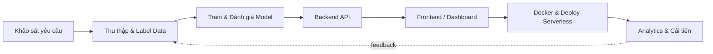

<!-- ============================================================ -->
<!--  GitHub Profile README · Đinh Tấn Huy                        -->
<!--  Thay toàn bộ `YOUR_USERNAME` bằng GitHub username của bạn   -->
<!-- ============================================================ -->

<div align="center">


<a href="https://git.io/typing-svg">
  
</a>

<br/>


<br/><br/>


</div>

---

## 👋 Xin chào, mình là HUYTKING

```text
> whoami
Đinh Tấn Huy — IT Student @ FPT University Quy Nhơn

> role
End-to-End Developer · Full-Stack & AI/System Engineer

> mission
Biến dữ liệu thô thành sản phẩm chạy thật: từ khảo sát, label data, train model,
dựng backend/frontend, đóng gói Docker, deploy serverless cho tới dashboard analytics.
```

- 🎓 Sinh viên Công nghệ Thông tin tại **FPT University Quy Nhơn**
- 🔁 Phong cách **End-to-End**: tự đảm nhận toàn bộ vòng đời sản phẩm, không bỏ sót khâu nào
- 👁️ Đam mê **Computer Vision, Edge AI** và các hệ thống **IoT/Embedded** chạy thời gian thực
- 🌏 Giao tiếp tiếng Anh (**IELTS 6.5**) và tiếng Nhật (**JLPT N3**), sẵn sàng làm việc trong môi trường quốc tế
- 🤝 Đang tìm kiếm cơ hội **Internship / Collaboration** về Full-Stack, AI Engineer hoặc IoT

---

## 🧰 Tech Stack

### 🔤 Master Languages
<p>
  
  
  
  
  
  
  
</p>

### 🤖 AI · Computer Vision · Data Engineering
<p>
  
  
  
  
  
  
  
  
  
  
</p>

### ⚙️ Backend & Database
<p>
  
  
  
  
  
  
  
</p>

### 🎨 Frontend & UI
<p>
  
  
  
  
  
  
</p>

### ☁️ DevOps · Cloud · Embedded/IoT
<p>
  
  
  
  
  
  
  
  
  
</p>

---

## 🚀 Kho bài toán & dự án nổi bật (Full-Cycle / End-to-End)

> Mỗi dự án đều đi trọn vòng đời: **Khảo sát → Label/Preprocess → Train → Backend → Frontend → Deploy → Analytics**.

| # | Bài toán / Dự án | Thách thức & Giải pháp (Label → Train → BE → FE → Deploy) | Tech Stack |
|:-:|---|---|---|
| 1 | **🎓 Hệ thống giám sát đa thức cảm xúc & hành vi lớp học Real-time**<br/>*(Computer Vision + Fullstack Pipeline)* | **Thách thức:** nhận diện đồng thời nhiều khuôn mặt, cảm xúc và hành vi trong luồng video với độ trễ thấp.<br/>**Giải pháp:** tự thu thập & **label dataset** → **train YOLO** kết hợp **DeepFace/MediaPipe** → pipeline xử lý stream video → **Backend ghi log vào MongoDB** → **Web Dashboard** hiển thị analytics theo thời gian thực. | `Python` `YOLO` `DeepFace` `MediaPipe` `OpenCV` `MongoDB` `React` |
| 2 | **🚗 Nhận diện biển số xe & quản lý bãi xe thông minh** | **Thách thức:** biển số bị nghiêng, mờ, thiếu sáng; cần tra cứu và lưu vết vào/ra chính xác.<br/>**Giải pháp:** **preprocess ảnh** → **train model OCR/YOLO** → viết **RESTful API** → kết nối **PostgreSQL** → giao diện quản lý bãi xe. | `Python` `YOLO` `OCR` `OpenCV` `Node.js` `Express` `PostgreSQL` |
| 3 | **☀️ Mô phỏng năng lượng mặt trời Dual-Axis & giám sát IoT ESP32** | **Thách thức:** tối ưu hướng tấm pin theo hai trục và truyền dữ liệu cảm biến ổn định.<br/>**Giải pháp:** lập trình nhúng **ESP32** đọc cảm biến → mô phỏng Dual-Axis trên **Canvas/Gazebo ROS** → đẩy dữ liệu lên **Serverless Redis** → **Streamlit Dashboard**. | `C/C++` `ESP32` `Arduino` `ROS` `Gazebo` `Upstash Redis` `Streamlit` |
| 4 | **🛸 Hạ tầng logistics droning & bản đồ floor topology trong nhà** | **Thách thức:** định vị và di chuyển trong không gian kín, không có GPS.<br/>**Giải pháp:** xây dựng **topology không gian 3D/Point Cloud** → mô phỏng chuyển động bằng **ROS/Gazebo** → **tối ưu thuật toán đường đi**. | `ROS` `Gazebo` `Python` `C++` `Point Cloud` `Path Planning` |
| 5 | **🛒 benh.shop: Serverless E-Commerce / Web Platform** | **Thách thức:** hệ thống thương mại điện tử nhẹ, nhanh, chi phí vận hành thấp.<br/>**Giải pháp:** thiết kế **schema Redis/PostgreSQL** → xây **Backend Serverless API** → **deploy Vercel** → **Frontend UI** mượt mà. | `Next.js` `TypeScript` `TailwindCSS` `Redis` `PostgreSQL` `Vercel` |

<details>
<summary><b>🔎 Xem quy trình End-to-End mình thường áp dụng</b></summary>

<br/>



</details>

---

## 🏆 Thành tích, cuộc thi & hoạt động

> ✏️ *Cập nhật các mốc dưới đây theo thông tin thực tế của bạn (điểm số, giải thưởng, năm học).*

| Mốc | Hoạt động | Ghi chú |
|:-:|---|---|
| 🎯 | **ADY201m** · Dự án môn học | Phân tích & xử lý dữ liệu, trình bày insight bằng trực quan hóa |
| 🧠 | **DAP391m** · Dự án môn học | Ứng dụng AI/Data vào bài toán thực tế |
| 🤖 | **MAI391** · Dự án môn học | Nền tảng toán cho AI, áp dụng vào xây dựng và đánh giá model |
| 💻 | **Hackathon** | *(Điền tên cuộc thi · năm · kết quả)* |
| 🏅 | **OLP Tin học** | *(Điền cấp thi · năm · kết quả)* |
| 🏫 | **Dự án / giải thưởng cấp trường** | *(Điền tên dự án · kết quả)* |
| 🌐 | **Chứng chỉ ngoại ngữ** | IELTS 6.5 · JLPT N3 |

---

## 📊 GitHub Stats & Metrics

<div align="center">


<br/>


<br/>


</div>

---

## 📫 Contact & Connect

<div align="center">

<a href="mailto:your.email@gmail.com"></a>
<a href="https://www.linkedin.com/in/YOUR_LINKEDIN/"></a>
<a href="https://your-portfolio.vercel.app"></a>
<a href="https://www.facebook.com/YOUR_FACEBOOK"></a>

<br/><br/>

*"Dữ liệu là nguyên liệu, model là công cụ, sản phẩm chạy thật mới là đích đến."* 🚀


</div>
